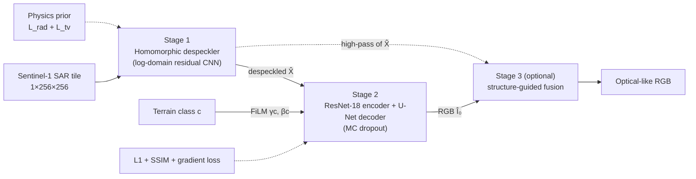

# GeoColor AI: Physics-Guided SAR-to-Optical Colorization

[](#️-limitations)
[](https://pytorch.org/)
[](https://dataspace.copernicus.eu/)
[](https://www.sih.gov.in/)
[](https://www.python.org/downloads/)
[](#4-reproduce-every-number)
[](LICENSE)

**All-weather radar vision, in colour.** This project turns grainy, single-channel Sentinel-1 radar images into
optical-like colour maps, and measures honestly how well that works on places the model has never seen.

🛰️ **Sees through clouds, rain, smoke and darkness** using Sentinel-1 C-band SAR
🧹 **Despeckles first, colours second**: a despeckling stage trained with a speckle-physics prior, no clean images needed
🧭 **Pretrained ResNet-18 encoder + terrain conditioning** for stable, fast training
📏 **Leakage-free benchmark**: scene-level split, 9 models trained under an identical budget, paired significance tests
🔁 **Every number is reproducible** from the scripts in this repository

[Summary](#-executive-summary--problem-statement) • [Results](#-results-at-a-glance) • [Method](#-method) •
[Benchmark](#-benchmark-protocol) • [Detailed results](#-detailed-results) • [Getting started](#-getting-started) •
[Dashboard](#️-interactive-dashboard) • [Limitations](#️-limitations) • [Paper](#-paper) • [Team](#-team)

---

> [!IMPORTANT]
> **Correction notice.** Earlier versions of this repository (and of our report) listed PSNR 24.87 dB, SSIM 0.816,
> SAM 6.0°, EPI 0.822, ENL 152.18 and "PASS" against fixed targets, together with Pix2Pix, CycleGAN and Swin
> baseline numbers. **Those numbers were invalid.** The old `eval_direct.py` multiplied, offset and clipped every metric
> into a preset target range, and the baseline rows were never measured. That script has been deleted. All results on
> this page are raw measurements produced by [`evaluate.py`](evaluate.py) on held-out scenes and can be regenerated
> with the commands in [Reproduce every number](#4-reproduce-every-number).

---

## 📌 Executive Summary & Problem Statement

Optical satellites (Sentinel-2, Landsat) cannot see through cloud, smoke or darkness, which is exactly when
disaster-response teams need imagery most. Synthetic Aperture Radar (SAR) solves the visibility problem: it is an active
microwave sensor that images day and night in almost any weather. It creates a different problem, though. Raw SAR is a
grainy, monochrome backscatter image corrupted by multiplicative *speckle*, and only trained radar analysts can read it
quickly.

This project addresses **ISRO Smart India Hackathon problem statement SIH1733**:

> **"SAR Image Colorization for Comprehensive Insight using Deep Learning Model"**

Generic image-to-image translation models (Pix2Pix, CycleGAN) are a poor fit for radar:

| # | Problem | Consequence | What we do |
| :--- | :--- | :--- | :--- |
| 1 | Speckle removal and colour translation are learned *simultaneously* | Speckle is mistaken for land-cover texture | A dedicated despeckling stage runs first |
| 2 | No radar physics in the loss | Despeckling can shift image brightness | A physics prior from the speckle model ($\mathbb{E}[F]=1$) |
| 3 | Adversarial (GAN) training on unseen scenes | Vivid but wrong colours, blob artefacts, unstable training | Measured: the GAN costs ~2.3 dB, so the final model drops it |
| 4 | Patch-level random splits | Overlapping patches leak into the test set and inflate scores | Scene-level split: no test scene is ever seen in training |

---

## 🏆 Results at a Glance

Results on **600 test tiles from 8 scenes never used in training** (150 per terrain class). PSNR, SSIM, SAM and GMSD are
computed against the co-registered Sentinel-2 image; *p* is a paired Wilcoxon signed-rank test against the final model.

| Method | PSNR (dB) ↑ | SSIM ↑ | SAM (°) ↓ | GMSD ↓ | p (PSNR vs final) |
|---|:---:|:---:|:---:|:---:|:---:|
| SAR shown as grey (floor) | 9.86 | 0.037 | 9.41 | 0.261 | < 0.001 |
| Mean training colour (floor) | 13.96 | 0.238 | 9.88 | 0.288 | < 0.001 |
| U-Net, L1 loss only | 14.14 | 0.237 | 11.23 | 0.274 | 0.013 |
| Pix2Pix (Isola et al., 2017) | 12.58 | 0.149 | 16.96 | 0.241 | < 0.001 |
| Lee filter + Pix2Pix | 12.64 | 0.133 | 12.42 | 0.247 | < 0.001 |
| Ours v1 (with GAN) | 12.14 | 0.161 | 14.45 | 0.249 | < 0.001 |
| Ours without GAN | 14.47 | 0.247 | 11.74 | 0.279 | 0.002 |
| **Ours (final)** | **14.33** | **0.248** | **11.81** | **0.278** | ref. |
| Ours (final), run without terrain label | 14.55 | 0.249 | 11.26 | 0.279 | < 0.001 |
| Ours (final) + luminance fusion (α=0.1) | 14.37 | 0.233 | 11.65 | 0.269 | 0.009 |
| Ours (final) + detail injection (β=0.25) | 14.33 | 0.242 | 11.91 | 0.276 | 0.141 |

<p align="center"></p>

### Key findings

| | Finding |
| :---: | :--- |
| ✅ | The final model beats **Pix2Pix by 1.75 dB** PSNR and the **U-Net regressor by 0.18 dB** (p = 0.013), with the highest SSIM. |
| ✅ | The **physics prior works**: without it the despeckling stage shifts brightness (mean of ratio 1.348); with it the bias disappears (0.997). |
| ✅ | **Dropping the GAN** is the single biggest improvement (+2.3 dB) on unseen scenes. |
| ⚠️ | The final model is only **0.37 dB above predicting the average colour**. Colourizing *unseen* scenes from one radar channel is far from solved. |
| ⚠️ | "Ours without GAN" has slightly higher test PSNR (14.47) than the validation-selected final model; the pretrained encoder mainly makes training faster and more stable. |
| ❌ | **Terrain conditioning did not transfer**: the label helped on the validation scenes but not on the test scenes (label-free inference scored 0.22 dB higher). |
| ❌ | **MC-dropout uncertainty does not rank errors** (Spearman 0.005, AUSE 0.068), so it must not be presented as a "hallucination guardrail". |
| ❌ | **SAR luminance fusion gives no fidelity gain**; at the old setting (α = 0.7) it costs 2.6 dB. |

> **Selection rule.** Every choice (checkpoint, final configuration, fusion strength, label vs. no label) was made on the
> **validation** scenes. The test set was used only once, for the numbers above.

---

## 🧠 Method



### Stage 1: homomorphic despeckling trained with a physics prior

SAR intensity follows the multiplicative speckle model

$$Y = X \cdot F,\qquad \mathbb{E}[F]=1 \quad\Longrightarrow\quad \log Y = \log X + \log F .$$

A residual CNN (3×3 conv, two 64-channel residual blocks, tanh-bounded output) predicts $\widehat{\log F}$ and returns
$\hat X = \exp(\log Y - \widehat{\log F})$. There is no clean reference image, so the stage is supervised by two
properties of the speckle model ([`losses.py`](losses.py)):

$$\mathcal{L}_{rad} = \big\| \mathcal{A}_7(\hat X) - \mathcal{A}_7(Y) \big\|_1 ,\qquad \mathcal{L}_{tv} = \big\| \nabla \log(\hat X+\epsilon) \big\|_1$$

* **Radiometric preservation** ($\mathcal{L}_{rad}$): because $\mathbb{E}[Y]=X$, the local multi-look mean of the observation
  is an unbiased estimate of the reflectivity, so despeckling must not change it.
* **Log-domain total variation** ($\mathcal{L}_{tv}$): in the log domain speckle is additive and high-frequency, so the clean
  log-reflectivity should be piecewise smooth.

### Stage 2: colorization

* **Encoder:** stem and layers 1–3 of an ImageNet-pretrained ResNet-18 (SAR replicated to 3 channels and ImageNet-normalised).
* **Decoder:** bilinear upsampling (no checkerboard artefacts), skip connections, and spatial dropout (p = 0.15 / 0.10 / 0.05) for MC sampling.
* **Terrain FiLM:** a learned embedding of the terrain class scales and shifts the bottleneck and decoder features,
  $h \mapsto h(1+\gamma_c)+\beta_c$. A fifth "unknown" embedding is trained by dropping the label 20 % of the time, so the model also runs without a label.
* **Loss** (λ_adv = 1 in v1, 0 in the final model):

$$\mathcal{L} = 100\,\mathcal{L}_1 + 10\,(1-\mathrm{SSIM}) + 10\,\mathcal{L}_{grad} + 10\,\mathcal{L}_{rad} + 0.5\,\mathcal{L}_{tv} + \lambda_{adv}\,\mathcal{L}_{GAN}$$

### Stage 3: optional structure-guided fusion ([`fusion.py`](fusion.py))

| Variant | Formula (CIELAB) | Verdict |
| :--- | :--- | :--- |
| Luminance replacement | $L^* = \alpha S + (1-\alpha) L^*_{pred}$ | copies SAR *brightness*, which is not optical brightness; −2.6 dB at α = 0.7 |
| Detail injection | $L^* = L^*_{pred} + \beta\,\frac{\sigma(L^*_{pred})}{\sigma(S)}\,(S - G_\sigma * S)$ | sharper edges at a much smaller cost, but no fidelity gain |

Fusion is offered in the dashboard as a display option only.

### Epistemic uncertainty

At inference the batch-norm layers stay in eval mode and only decoder dropout is sampled over $T = 10$ passes, giving a
per-pixel predictive mean and variance. The original prototype put the whole network in training mode, which corrupts the
batch-norm statistics, and with one pass it returned a scaled edge map instead of an uncertainty.

---

## 🔬 Benchmark Protocol

### Data

16,000 co-registered Sentinel-1 / Sentinel-2 pairs (256 × 256 px, 8-bit PNG) derived from **SEN12MS**, in four terrain
classes and 30 scenes.

### Leakage-free, scene-level split ([`splits.py`](splits.py) → `splits.json`)

| Split | Tiles | Scenes | Classes |
| :--- | :---: | :---: | :--- |
| Train | 11,014 | 18 | agriculture, barren, grassland, urban |
| Validation | 1,139 | 4 | barren, grassland, urban |
| Test | 3,847 (600 evaluated, 150 per class) | 8 | all four |

No scene appears in two splits; `splits.py` asserts this.

### Matched training budget ([`train.py`](train.py), [`run_all.py`](run_all.py))

Every model gets the same budget: 4,000 iterations · batch 8 · random 128 × 128 crops + flips + 90° rotations · Adam
2 × 10⁻⁴ (β₁ = 0.5) with cosine decay · fp32 · seed 42 · one 2 GB NVIDIA MX550 laptop GPU. Checkpoints are selected by
validation L1.

| Variant key | Description |
| :--- | :--- |
| `unet_l1` | U-Net regression, L1 only |
| `pix2pix` | U-Net + PatchGAN, L1 + adversarial (Isola et al., 2017) |
| `lee_pix2pix` | classical Lee filter (7×7, L = 40, the median ENL of the training scenes) followed by Pix2Pix |
| `ours_nodesp` | v1 loss without the despeckling stage |
| `ours_nophys` | v1 with the despeckler trained end-to-end only (no physics prior) |
| `ours` | **v1**: despeckler + physics prior + L1/SSIM/gradient + GAN |
| `ours_cond` | v1 + terrain FiLM |
| `ours_noadv` | v1 without the GAN |
| `ours_r18_cond_noadv` | **final**: no GAN + pretrained ResNet-18 encoder + terrain FiLM |

### Metrics ([`metrics.py`](metrics.py))

| Group | Metric | Meaning |
| :--- | :--- | :--- |
| Fidelity | PSNR, SSIM | pixel and structural agreement with Sentinel-2 |
| Colour | SAM (°) | spectral angle; it rewards hue-neutral output, so read it together with PSNR/SSIM |
| Edges | GMSD | gradient-magnitude similarity deviation (lower = edges closer to the reference) |
| Despeckling | ENL, EPI, mean of ratio | speckle suppression, edge preservation, radiometric bias (ideal ratio 1.000) |
| Uncertainty | AUSE, Spearman ρ | does the uncertainty rank pixels by their true error? |
| Statistics | paired Wilcoxon | significance of every difference against the final model |

---

## 📊 Detailed Results

### Ablation

| Variant | Despeckle stage | Physics prior | SSIM+grad loss | GAN | ResNet-18 | Terrain FiLM | PSNR | SSIM | SAM |
|---|:---:|:---:|:---:|:---:|:---:|:---:|:---:|:---:|:---:|
| U-Net, L1 loss only | — | — | — | — | — | — | 14.14 | 0.237 | 11.23 |
| Pix2Pix (Isola et al., 2017) | — | — | — | ✅ | — | — | 12.58 | 0.149 | 16.96 |
| Ours v1 without despeckling stage | — | — | ✅ | ✅ | — | — | 12.55 | 0.153 | 14.07 |
| Ours v1 without physics prior | ✅ | — | ✅ | ✅ | — | — | 12.54 | 0.173 | 16.67 |
| Ours v1 (with GAN) | ✅ | ✅ | ✅ | ✅ | — | — | 12.14 | 0.161 | 14.45 |
| Ours v1 + terrain FiLM | ✅ | ✅ | ✅ | ✅ | — | ✅ | 11.84 | 0.156 | 14.27 |
| Ours without GAN | ✅ | ✅ | ✅ | — | — | — | 14.47 | 0.247 | 11.74 |
| **Ours (final)** | ✅ | ✅ | ✅ | — | ✅ | ✅ | 14.33 | 0.248 | 11.81 |

### Despeckling quality (no reference; the same homogeneous blocks for every filter)

| Filter | ENL ↑ | EPI ↑ | Mean of ratio (ideal 1.000) |
|---|:---:|:---:|:---:|
| Raw SAR (no filter) | 39.4 | 1.000 | 1.000 |
| Lee filter (7×7, L=40) | 171.7 | 0.858 | 0.988 |
| Stage 1 without physics prior | 14.7 | 0.608 | **1.348** |
| Stage 1 + physics prior (v1) | 43.9 | 0.599 | 0.997 |
| Stage 1 + prior, no GAN | 49.5 | 0.624 | 0.998 |
| Stage 1 + prior (final model) | 54.7 | 0.903 | 0.986 |

Without the prior the stage *adds* texture (ENL drops to 14.7) and brightens the image by 35 %. With the prior it is a mild,
edge-preserving, radiometrically unbiased filter. The Lee filter smooths more strongly.

### Per terrain (PSNR dB / SAM °)

| Method | Agriculture | Barren | Grassland | Urban |
|---|:---:|:---:|:---:|:---:|
| Mean training colour (floor) | 13.77 / 9.3° | 14.29 / 5.2° | 14.25 / 18.1° | 13.52 / 6.9° |
| U-Net, L1 loss only | 13.85 / 10.4° | 14.41 / 6.4° | 14.79 / 20.4° | 13.53 / 7.8° |
| Pix2Pix (Isola et al., 2017) | 12.24 / 15.3° | 12.52 / 9.8° | 13.19 / 30.9° | 12.36 / 11.9° |
| Lee filter + Pix2Pix | 11.46 / 11.4° | 12.05 / 7.5° | 14.59 / 19.8° | 12.44 / 11.0° |
| **Ours (final)** | 13.40 / 9.1° | 14.48 / 3.9° | 15.53 / 26.6° | 13.89 / 7.6° |

<p align="center"></p>

### Qualitative results (test scenes, never seen in training)

<p align="center"></p>

GAN-based methods hallucinate saturated colours and blob artefacts. The final model produces muted but terrain-plausible
palettes. It misses the lake in the grassland tile (third row), colouring the smooth, dark SAR backscatter as grass.

### Uncertainty: a negative result

<p align="center">


</p>

Removing the most uncertain pixels first does **not** lower the error of the remaining pixels: the MC-dropout curve stays
close to random removal (AUSE 0.0675, Spearman ρ = 0.005, T = 10, 160 tiles). Averaging the passes changes PSNR by only
+0.02 dB. Here MC-dropout variance reflects decoder randomness, not colour ambiguity.

### Fusion sweep and training dynamics

<p align="center">


</p>

GAN-based models fluctuate strongly between checkpoints, while the pretrained-encoder model is stable from the first 500
iterations. Stage 1 doubles inference time (15.0 → 31.5 ms per 256 × 256 tile on an MX550), which is still interactive.

---

## 📁 Repository Structure

```text
GeoColor-AI-SAR-Colorization/
├── app.py              # Streamlit dashboard: 4-panel view, MC uncertainty, terrain selector, PNG export
├── splits.py           # leakage-free scene-level split  -> splits.json
├── dataset.py          # paired S1/S2 loader, random crop / flip / rot90 augmentation
├── models.py           # homomorphic despeckler, U-Net / ResNet-18 colorizer, FiLM, MC dropout, PatchGAN, Lee filter
├── losses.py           # composite loss + speckle physics prior (L_rad, L_tv)
├── train.py            # one script for every variant (identical budget), checkpoint/resume
├── run_all.py          # trains all variants sequentially, restarts stalled runs from the last checkpoint
├── evaluate.py         # PSNR, SSIM, SAM, GMSD, ENL, EPI, MoR, AUSE, Wilcoxon tests, validation-tuned fusion
├── metrics.py          # metric implementations (raw values, no rescaling)
├── fusion.py           # luminance replacement and detail injection
├── tiler.py            # Hann-window tiling for scenes larger than 256 × 256
├── timing.py           # parameter count and inference time
├── make_figures.py     # every figure, LaTeX table and number macro used in the paper
├── requirements.txt
├── splits.json         # the exact split used for all results
├── results/            # metrics.json, per_image.csv, timing.json, qualitative PNGs
├── runs/<variant>/     # training curves (log.csv)
└── paper/              # IEEE conference paper (LaTeX): main.tex, refs.bib, figs/, tables/
```

Not in git: `dataset/` (download separately) and `checkpoints/` (trained weights, see below).

---

## 🚀 Getting Started

### 1. Prerequisites

* Python 3.10–3.12
* An NVIDIA GPU is recommended (everything was developed on a 2 GB MX550); CPU inference works but is slow
* Git

### 2. Installation

```bash
git clone https://github.com/Gedipudidarshani/GeoColor-AI-SAR-Colorization.git
cd GeoColor-AI-SAR-Colorization
python -m venv venv
.\venv\Scripts\Activate.ps1          # Linux / macOS: source venv/bin/activate
pip install -r requirements.txt
```

### 3. Dataset

Place the paired tiles as:

```text
dataset/v_2/{agri,barrenland,grassland,urban}/{s1,s2}/ROIsXXXX_<season>_s{1,2}_<scene>_p<patch>.png
```

The tiles come from **SEN12MS** (Schmitt et al., 2019). Each `s1` file must have an `s2` file with the same name
(`_s1_` → `_s2_`).

### 4. Reproduce every number

```bash
python splits.py                 # 1. scene-level split  -> splits.json (already committed)
python run_all.py                # 2. train all 9 variants (~4 h on an MX550; resumes after interruptions)
python evaluate.py               # 3. benchmark on 600 held-out test tiles -> results/metrics.json
python timing.py                 # 4. inference cost -> results/timing.json
python make_figures.py           # 5. figures, LaTeX tables and number macros -> paper/
```

To train a single variant: `python train.py --variant ours_r18_cond_noadv --iters 4000`.

> [!TIP]
> **Laptop GPUs:** keep the charger connected and set *Windows → Settings → Power → Power mode* to **Best performance**.
> On battery or in *Balanced* mode the MX550 was capped at 300 MHz (about 10× slower). Do **not** enable fp16 autocast on
> this GPU: it was ~20× slower and produced NaNs.

### 5. Model weights

Trained checkpoints are not stored in git (`*.pth` is ignored). Run step 2 above, or ask the authors for the weights, and
place them in `checkpoints/<variant>.pth`.

---

## 🖥️ Interactive Dashboard

```bash
streamlit run app.py              # opens http://localhost:8501
```

* Loads the model selected on the validation set automatically (`results/metrics.json → main`).
* Four synchronized panels: **raw SAR**, **despeckled reflectivity**, **colorized RGB** and **MC-dropout uncertainty**.
* Sidebar: terrain selector (or *Unknown*), number of MC passes, fusion mode and strength (default: the validation-tuned value), display saturation.
* No-reference indicators for the uploaded tile (ENL on homogeneous blocks vs. raw, EPI, entropy, share of high-uncertainty pixels), plus PNG download.
* With no upload, it shows the held-out benchmark table.

<details>
<summary><b>Screenshots of the earlier prototype (v0)</b>: kept for history. The metric values shown in them come from the invalid evaluation and should be ignored.</summary>


</details>

---

## ⚠️ Limitations

1. **Non-simultaneous acquisitions.** Sentinel-1 and Sentinel-2 are not captured at the same moment, so pixel metrics are bounded by real scene change.
2. **Uncalibrated input.** The 8-bit PNG tiles are not calibrated σ⁰, so the speckle model is applied to quantised backscatter.
3. **Single polarization.** Only one SAR channel is used; dual-pol (VV + VH) is not exploited.
4. **Small budget.** Each model gets 4,000 iterations on a 2 GB GPU. Absolute numbers would likely rise with longer training, and the ranking could change.
5. **Few test scenes.** The 8 test scenes support per-tile significance tests, but conclusions about transfer across scenes (e.g. terrain conditioning) need more scenes.
6. **Colours are estimates.** Outputs are learned approximations of optical appearance, not measurements, and must not be used for spectral analysis.

---

## 🔭 Future Work

- [x] Retrain Pix2Pix and a U-Net baseline on identical splits *(done; CycleGAN, Swin and diffusion not yet)*
- [x] Ablations: despeckling stage, physics prior, GAN, pretrained encoder, terrain conditioning *(done)*
- [x] Per-land-cover metrics *(done)*
- [x] Test whether MC-dropout uncertainty correlates with real error *(done; it does not)*
- [ ] Calibrated uncertainty: deep ensembles or conformal prediction
- [ ] Dual-polarization (VV + VH) and multi-temporal Sentinel-1 input
- [ ] Longer training on more scenes (cloud GPU), and more test scenes for cross-scene conclusions
- [ ] Perceptual metrics (LPIPS, FID) alongside PSNR/SSIM
- [ ] Conditional diffusion and Swin Transformer generators under the same benchmark
- [ ] Native GeoTIFF input/output with CRS preservation; REST API, Docker image, QGIS plugin
- [ ] Downstream validation: does colorization help flood or land-cover mapping?

---

## 📄 Paper

The IEEE conference manuscript is in [`paper/`](paper/) (IEEEtran LaTeX). Every number in the text is a `\newcommand`
macro generated by `make_figures.py` from `results/metrics.json`, so the paper cannot drift from the measured results.
To build it, upload the whole `paper/` folder to Overleaf, or run
`pdflatex main && bibtex main && pdflatex main && pdflatex main` inside `paper/`.

---

## 🌱 Real-World Impact & SDG Alignment

| SDG | Use case |
| :--- | :--- |
| **SDG 13: Climate Action** | All-weather flood, cyclone and storm-damage mapping |
| **SDG 15: Life on Land** | Deforestation and land-degradation monitoring in cloudy regions |
| **SDG 11: Sustainable Cities** | Urban growth monitoring |
| **SDG 6: Clean Water** | River, reservoir and wetland monitoring |
| **SDG 2: Zero Hunger** | Crop monitoring and agricultural damage assessment |

---

## ⚖️ Disclaimer

This is an academic research prototype. Colorized outputs are **model-generated approximations**, not optical
observations, and must not be used alone for safety-critical, defence or disaster-response decisions.

---

## 🙏 Acknowledgements

* **ISRO** and the **Smart India Hackathon** for problem statement SIH1733
* **ESA Copernicus** for open Sentinel-1 and Sentinel-2 data
* **Technical University of Munich** for the SEN12MS dataset
* **Saveetha Engineering College** and our mentors for guidance and support

---

## 📄 License

Released under the **MIT License**. See [`LICENSE`](LICENSE).

---

## 📝 Citation

```bibtex
@misc{keerthana2026geocolor,
  title        = {Physics-Guided SAR-to-Optical Colorization with Radiometry-Preserving Despeckling:
                  A Leakage-Free Benchmark on Sentinel-1/2},
  author       = { Kolli Amos Daniel, Dr. K. Micheal Mahesh and Selvanayaki and Keerthana P, Gedipudi darshani
                  and Yenuganti Prathyusha},
  year         = {2026},
  howpublished = {\url{https://github.com/keerthanaapillaram/GeoColor-AI-SAR-Colorization}},
  note         = {Saveetha Engineering College}
}
```

---

## 📚 References

1. P. Isola, J.-Y. Zhu, T. Zhou, and A. A. Efros, "Image-to-image translation with conditional adversarial networks," *Proc. IEEE CVPR*, 2017.
2. J.-Y. Zhu, T. Park, P. Isola, and A. A. Efros, "Unpaired image-to-image translation using cycle-consistent adversarial networks," *Proc. IEEE ICCV*, 2017.
3. M. Fuentes Reyes, S. Auer, N. Merkle, C. Henry, and M. Schmitt, "SAR-to-optical image translation based on conditional generative adversarial networks—optimization, opportunities and limits," *Remote Sensing*, vol. 11, no. 17, 2019.
4. M. Schmitt, L. H. Hughes, C. Qiu, and X. X. Zhu, "SEN12MS—A curated dataset of georeferenced multi-spectral Sentinel-1/2 imagery for deep learning and data fusion," *ISPRS Annals*, vol. IV-2/W7, 2019.
5. J. W. Goodman, "Some fundamental properties of speckle," *J. Opt. Soc. Amer.*, vol. 66, no. 11, 1976.
6. J.-S. Lee, "Digital image enhancement and noise filtering by use of local statistics," *IEEE TPAMI*, vol. PAMI-2, no. 2, 1980.
7. L. I. Rudin, S. Osher, and E. Fatemi, "Nonlinear total variation based noise removal algorithms," *Physica D*, vol. 60, 1992.
8. Y. Gal and Z. Ghahramani, "Dropout as a Bayesian approximation: Representing model uncertainty in deep learning," *Proc. ICML*, 2016.
9. E. Ilg *et al.*, "Uncertainty estimates and multi-hypotheses networks for optical flow," *Proc. ECCV*, 2018.
10. E. Perez, F. Strub, H. de Vries, V. Dumoulin, and A. Courville, "FiLM: Visual reasoning with a general conditioning layer," *Proc. AAAI*, 2018.
11. Y. Blau and T. Michaeli, "The perception-distortion tradeoff," *Proc. IEEE/CVF CVPR*, 2018.
12. Z. Wang, A. C. Bovik, H. R. Sheikh, and E. P. Simoncelli, "Image quality assessment: From error visibility to structural similarity," *IEEE TIP*, vol. 13, no. 4, 2004.
13. W. Xue, L. Zhang, X. Mou, and A. C. Bovik, "Gradient magnitude similarity deviation: A highly efficient perceptual image quality index," *IEEE TIP*, vol. 23, no. 2, 2014.

The full bibliography is in [`paper/refs.bib`](paper/refs.bib).

---

## 👥 Team

* **P Keerthana**, Artificial Intelligence & Machine Learning
* **Gedipudi Darshani**, Artificial Intelligence & Data Science
* **Yenuganti Prathyusha**, Artificial Intelligence & Machine Learning

**Mentors:** Kolli Amos Daniel · Dr. K. Micheal Mahesh · Selvanayaki S
**Institution:** Saveetha Engineering College, Chennai, India
